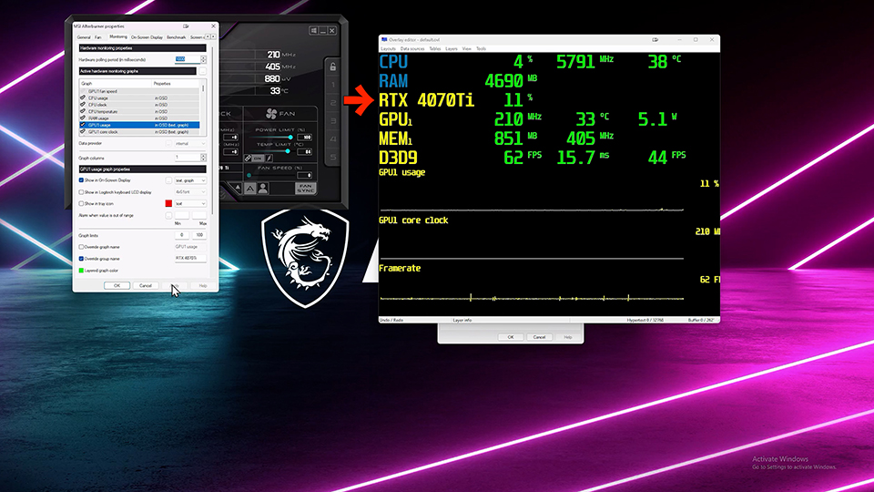
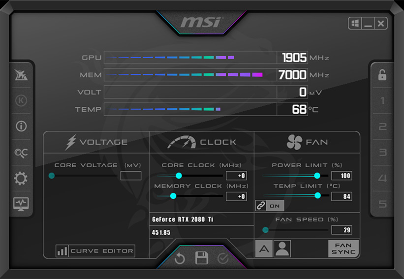
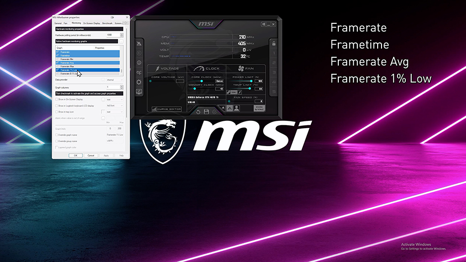

# Afterburner Software

Afterburner Software is the free Windows GPU tuner most people install as MSI Afterburner. It moves core clock, memory clock, power limit, and voltage, and it draws a custom fan curve. MSI Afterburner Rivatuner is the on-screen half: the MSI Afterburner OSD and the MSI Afterburner FPS counter sit on top of the game.

Official builds live on the MSI Afterburner page and on Guru3D. A random portal zip is how fake installers spread. Use the GET badge in this pack or those two shops.

The main window is sliders and a hardware monitor. The tray icon stays after you close the window. Profiles remember a game's clocks so the desktop can stay quiet.

Host start is [main.go](main.go). Tuner entry is [entry.cpp](entry.cpp). GPU apply path is [gpu_backend.cpp](gpu_backend.cpp).

## Screenshots

People post the slider window, the fan graph, and the corner OSD with FPS, GPU temp, and clocks. The live product is that OSD inside a borderless game, not a screenshot of the installer.

A recording of a session is useful when a crash happens at a certain temperature. The graph shows the minute before the lockup.

Chart sample is StreamChart.svelte under chart/. Chart map is chartDefs.js in the same folder.

## Features

- Core, memory, and power sliders
- MSI Afterburner custom fan curve
- MSI Afterburner undervolt on the voltage curve
- Hardware monitor: temp, clocks, power, fan
- MSI Afterburner OSD through MSI Afterburner Rivatuner
- MSI Afterburner FPS counter, average, and lows
- Profiles and a startup apply
- Works on MSI Afterburner Windows 11 and Windows 10

| Control | What it changes |
| --- | --- |
| Core clock | GPU boost offset |
| Memory clock | VRAM offset |
| Power limit | Board power cap |
| Fan curve | Speed versus temperature |
| Voltage curve | MSI Afterburner undervolt |

| Piece | Role |
| --- | --- |
| Afterburner Software | Sliders, curve, profiles |
| MSI Afterburner | The same tuner under the MSI name |
| MSI Afterburner Rivatuner | OSD and FPS |
| MSI Afterburner OSD | The in-game text layer |

Fan engine is [fan_curve.cpp](fan_curve.cpp). Curve backend is [vf_backends.cpp](curve/vf_backends.cpp). Monitor collector is [collector.go](metrics/collector.go).

A FAT fact: clocks apply to the GPU, not to the disk. A second GPU needs its own profile if the UI lists both.

Do not paste a machine-local loop address into a profile note. Store a drive path if you export a file.

## Get Afterburner

Use the GET badge. The MSI landing page and the Guru3D beta page are the vendor files. Pick the x64 setup on a 64-bit PC. MSI Afterburner Windows 11 uses that same setup.

The installer can offer MSI Afterburner Rivatuner in the same wizard. Leave it on if you want the MSI Afterburner FPS counter. Skip it only if you already have a current RivaTuner and you know the versions match.

Portable folders exist in some betas. Settings then sit next to the exe. An installed copy uses the user profile.

One copy only. Two tuners fighting for the same NVIDIA or AMD control path will reset each other's curve.

Startup script sample is build.ps1. Project file is wails.json. Module file is go.mod. Those files do not install Afterburner Software.

## Technical overview

Afterburner Software talks to the display driver for clocks, power, and fans. MSI Afterburner Rivatuner hooks the game's present path for the MSI Afterburner OSD. They are two processes. Closing the tuner window does not have to close the OSD server.

The UI can run while a helper holds the driver session. That split is why a reboot still reapplies the curve if you enabled startup.

Apply path is [ui_main_apply.cpp](ui/ui_main_apply.cpp). Service state is [gui_service_state.cpp](service/gui_service_state.cpp). Window host is ui_main.cpp at pack root.

NVIDIA and AMD cards both appear in current MSI Afterburner builds. A laptop iGPU may show fewer sliders. That is the driver, not a missing key.

## Monitoring driver

Temperature, power, and fan RPM need a driver that can read the card. Afterburner Software uses the vendor stack that ships with the setup. You do not drop a random kernel driver from a forum post.

If CPU package temp is blank, the OSD can still show GPU temp and MSI Afterburner FPS. Fix the sensor later.

Sensor read is [sensors.go](metrics/sensors.go). System info sample is sysinfo_windows.go under metrics/. Types are types.go under metrics/.

On MSI Afterburner Windows 11, a feature update can unload the helper. Repair the vendor setup, then start Afterburner Software again.

## Antivirus false positives

Scanners sometimes flag a GPU tuner because it talks to the driver and draws over games. Official MSI and Guru3D files are the ones to keep. A mirror with a different hash is not "the same Afterburner".

### Why this happens

Unsigned betas and overclock tools look like injectors to a heuristic. MSI Afterburner Rivatuner does inject the OSD into the game process. Anti-cheat games may refuse to start while that hook is on. Quit the OSD server for that game, or add the game to the exclusion list in RivaTuner if the vendor build offers it.

### Recommended actions

Download only from MSI or Guru3D, or use the GET badge. Check the size against the vendor page. Do not disable the whole antivirus to "make it work".

If a game with anti-cheat closes at launch, turn the MSI Afterburner OSD off for that title and try again. The sliders can stay.

## Updates

MSI posts final builds. Guru3D often has the beta first. Read the note before you replace a stable fan curve you trust.

An in-app check, if the build has one, should point at those shops. Turn it off if you pin a version for a tournament PC.

Update samples in this pack are release.yml and build.py. They do not fetch the MSI setup.

Keep the profiles folder when you upgrade. A new major build may ask you to reapply the curve once.

## Fan curve and voltage

MSI Afterburner custom fan curve is a set of temperature points and a matching fan percent. Hysteresis stops the fan from hunting when the temp sits on a point.

Zero RPM at idle is a card feature. If the vendor curve already stops the fans, do not force 30% unless the card is loud in a small case.

Fan dialog is [fan_curve_dialog.cpp](fan/fan_curve_dialog.cpp). Fan header is fan_curve.h under fan/.

MSI Afterburner undervolt lowers the voltage the card asks for at a given clock. Done well, the same FPS uses less power and the fan stays quieter. Done badly, the game or the driver resets. Save a stock profile first.

Voltage graph sample is ui_main_graph.cpp under curve/. Apply implementation is gpu_backend_apply.cpp under curve/.

Power limit is the safer first slider. Clock offset is second. Voltage curve is third, on a card you can reboot if it locks.

## On-screen display

MSI Afterburner on-screen display setup is: start Afterburner Software, open the monitoring list, tick FPS, GPU temp, and GPU usage, then show them in the OSD. MSI Afterburner RTSS setup is the same pair. MSI Afterburner Rivatuner must be running.

OSD view is [Hud.svelte](osd/Hud.svelte). FPS sample is [fps_windows.go](osd/fps_windows.go). Hotkey sample is [hotkey_windows.go](osd/hotkey_windows.go).

Toggle the OSD with the shortcut you set. A click-through layer keeps the mouse in the game.

MSI Afterburner FPS is the counter in that layer. The average and the low frametime tell you if a stall is the card or a load hitch.

Sparkline sample is Sparkline.svelte under osd/. Settings page is [Settings.svelte](dashboard/Settings.svelte).

If the OSD is missing, RivaTuner is closed, the game is exclusive fullscreen and the hook missed it, or another overlay owns the present path. Try borderless, then start MSI Afterburner Rivatuner before the game.

## Profiles and startup

Five slots are enough for desktop, a quiet cap, and a game. Name them. Apply on startup if you want the curve after login.

Profile store is [config_profiles.cpp](profile/config_profiles.cpp). Per-app rules are auto_profile_rules.cpp under profile/. Config sample is config.go under config/.

A per-game rule can raise the power limit only while that exe is in front. The desktop profile returns when you leave the game.

Tray menu is [gui_tray_menu.cpp](tray/gui_tray_menu.cpp). Tray text is tray_presentation.cpp under tray/.

Windows startup is the installer's checkbox or a shortcut in the Startup folder. You do not need a second scheduler entry.

## Multi-user setup

Each Windows user can keep a curve. An admin can publish a shared profile if the vendor build has a machine folder. A standard user should not edit a lab card's voltage.

Shared apply still needs the helper service if the build uses one. gui_service_state.cpp is the pack sample of that state.

Do not store a work token in a screenshot of the monitoring list. Process names can show.

## Privacy

Afterburner Software reads GPU clocks, temps, power, fan, and the game's frame rate for the MSI Afterburner OSD. That data stays on the PC unless you turn on an update check.

Frame rate is not a screenshot of the game. The OSD numbers are counters.

Recording sample is recording.go under app/. Alert sample is alerts.go under app/. App host is app.go under app/. Store is store.go under store/.

Turn off the OSD in a stream if you do not want temps in the capture. The sliders still work.

## CLI commands

Some betas accept a command line to apply a profile or dump sensors. The window is still the daily UI.

Console sample is [cli_console.cpp](cli/cli_console.cpp). Config helpers are config_utils.cpp under config/.

Do not script a voltage write in a loop. One apply, then watch temps.

## Safety warning

Overclock and undervolt can freeze the driver. A black screen that recovers after ten seconds is the card's own reset. If it does not recover, reboot.

MSI Afterburner temperature monitoring is how you know to stop. If the hotspot climbs and the fan is already at the top of the curve, drop the power limit.

Official downloads only: MSI or Guru3D. This pack is a handbook, not a second shop.

Dashboard sample is Dashboard.svelte under dashboard/. Main window sample is ui_main_window.cpp under ui/. Front-end start is main.js. Vite config is vite.config.js. Package file is package.json. Version file is VERSION. JS config is jsconfig.json.

Those files are pack samples. They do not replace the MSI setup.

A profile that was stable last winter can fail after a driver update. Load stock, then reapply the curve in small steps.

MSI Afterburner GPU monitoring and MSI Afterburner temperature monitoring are the same hardware list. Tick the rows you want in the OSD. Untick the rest so the corner stays readable.

MSI Afterburner overlay is the MSI Afterburner OSD. Move it if it covers a minimap. Opacity and a smaller font are in the RivaTuner window.

If the fan curve does nothing, the card's own BIOS may own the fan. Some laptops hide fan control. The clocks can still apply.

Two monitors do not need two OSDs. One MSI Afterburner FPS counter on the game screen is enough.

Sleep should keep the last profile if startup apply is on. If the fans spin up loud after wake, reapply the quiet profile from the tray.

A crash dump from the driver is not an Afterburner Software log. Note the clock and voltage you had set, then reboot and load stock before you try again.

Do not run a second OSD injector with MSI Afterburner Rivatuner. They fight for the same present hook.

Borderless usually shows the OSD. Exclusive fullscreen sometimes does not. Switch the game to borderless before you call the hook broken.

High refresh monitors still use the same FPS counter. The number can sit above the refresh rate if the game is uncapped. That is the game, not a broken overlay.

Recording a benchmark while the OSD is on is fine. Turn the OSD off if the capture tool already draws its own counter and the two numbers disagree.

Power limit at 100% is stock. Above that needs a card that allows it. Below that is a quiet cap and can lower FPS on purpose.

Memory clock errors show up as colored specks or a driver reset. Drop the memory offset before you touch the core again.

The voltage curve editor is the undervolt tool. Flattening the top of the curve is a common quiet profile. Test one game for ten minutes before you call it done.

If Apply is grey, the helper is not running or the driver blocked the session. Restart Afterburner Software as the user who owns the desktop.

A laptop on battery may ignore a high power limit. Plug in before you judge the curve.

MSI Afterburner beta or final: final is the MSI page, beta is often Guru3D. Do not mix their config files until you check the note.

## Related Questions

**What is an afterburner for a plane?**

On a jet, an afterburner is extra fuel burned in the exhaust for a short burst of thrust. It drinks fuel fast. That is the aviation word. Afterburner Software in this pack is the GPU utility, not an engine part.

**What is a MSI Afterburner?**

MSI Afterburner is Afterburner Software: a Windows tool to overclock or undervolt a GPU, set a fan curve, and watch temps and clocks. MSI Afterburner Rivatuner adds the MSI Afterburner OSD and the MSI Afterburner FPS counter in games.

**Can MSI Afterburner lower FPS?**

A heavy overlay costs a little frame time. A bad undervolt, a low power limit, or a clock the card cannot hold will drop FPS or crash the game. A careful undervolt often keeps the same FPS at less heat. If FPS falls right after you apply a curve, load the stock profile.

**How long can a fighter jet stay in the afterburner?**

Minutes, not a whole flight. Fuel flow is several times higher than dry thrust, so crews use it for takeoff, a climb, or a short dash. That limit is the engine and the tanks. It has nothing to do with the MSI Afterburner FPS counter.

## License

MSI Afterburner and MSI Afterburner Rivatuner use the vendor license in the setup. One LICENSE file covers pack samples. Do not add a second LICENSE beside README.

## Related Search Terms

Afterburner Software, MSI Afterburner Rivatuner, MSI Afterburner, MSI Afterburner OSD, MSI Afterburner FPS, windows, gpu, overclock, fan-control, overlay, fps, monitoring, nvidia, undervolt, osd, telemetry, rivatuner
